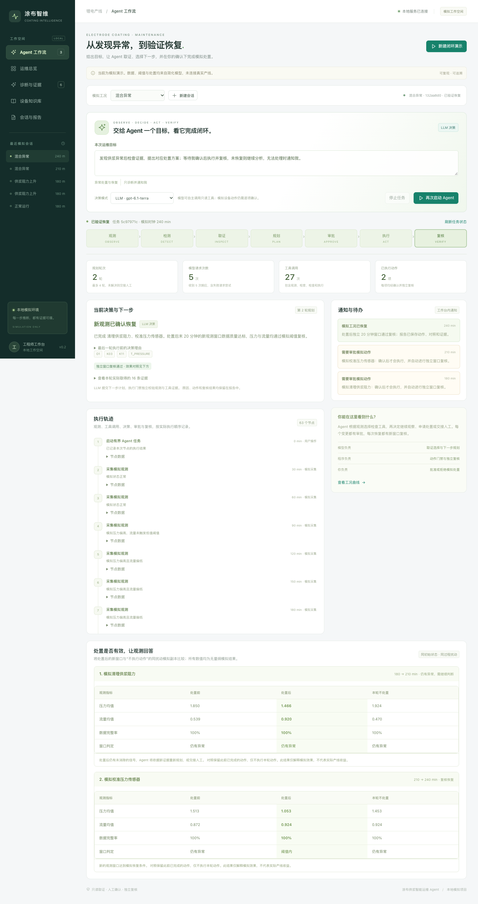
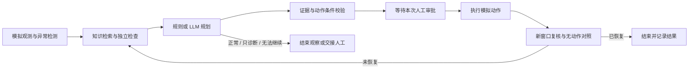

# 锂电极片涂布机供浆智能运维 Agent

用可复现的模拟工况，展示设备运维 Agent 如何从异常观测出发，检索知识、补充独立证据、提出处置计划，经过人工审批执行，再用新观测验证效果。支持离线规则规划和真实 LLM 工具调用，配有可追溯的运维工作台。

**已验证：六种工况闭环、真实模型八例验收、166 项自动化测试。** 混合异常需要两轮取证与审批；单次处置未恢复时，Agent 会重新规划。

> 本项目是个人实现的本地仿真原型，没有接入真实产线、PLC 或设备。观测、故障、阈值和动作效果均为自行设定的无量纲模拟，不代表企业工艺参数、工业诊断准确率或实际生产收益。



*真实模型的混合工况浏览器运行：分别批准清理与压力校准后恢复。另见[移动端工作台](output/playwright/agent-mobile-llm.png)。*

## 项目解决什么问题

压力偏高既可能来自供浆阻力，也可能来自传感器偏差；低流量还可能由泵效率下降引起。仅凭单个报警直接推荐“清理”，无法解释证据是否充分，也无法确认操作是否奏效。

本项目把这类问题实现为一个完整、可检查的任务流程：以观测和独立检查区分原因，把模型提出的计划与动作执行分开，再通过处置后的新窗口确认恢复。每轮工具证据、计划、审批、效果对照和转人工原因都能在界面与报告中查看。



## AI 做什么，程序负责什么

| 层次 | 实际职责 |
| --- | --- |
| LLM 计划器 | 根据目标选择只读工具，读取统计、检索知识、检查独立压力参考/泵效率/采集完整率，提交结构化计划；复核未通过后重新规划 |
| 确定性运行时 | 校验工具证据和动作条件，限制调用与动作预算，管理状态、审批、模拟执行、效果复核及审计 |
| 人工审批 | 每次动作单独确认；审批绑定当前会话版本，有效期 120 秒，拒绝、过期和重复确认不会执行 |
| 仿真器 | 生成观测，提供独立模拟检查，执行清理、校准、泵维护、采集恢复，并生成处置后的数据 |

`rules` 模式无需模型服务，使用确定性规则选择计划；`llm` 模式才进行真实模型调用。模型不能直接执行动作，也不会收到隐藏故障标签。LLM 规划不可用或校验失败时明确交接人工，记录 `source=llm_unavailable`，不静默替换成规则动作。

每次处置后续跑 30 分钟，以末尾 20 分钟的新窗口复核。同时从相同处置前状态生成一份不执行该动作的对照，使用共同过程扰动比较效果。混合工况保留每轮动作的独立对照；第二轮对照表示“已清理但未校准”。

## 六种工况，实际跑通到哪里

以下六例均通过离线规则和真实 LLM 的服务层流程验收；浏览器也逐一走通规则模式，并另行走通真实 LLM 的混合工况两轮审批。

| 工况 | 取证与处置路径 | 验收终点 |
| --- | --- | --- |
| 正常运行 `normal` | 观测正常，不申请动作 | `MONITORING`：本轮有界观察结束 |
| 供浆阻力上升 `blockage` | 高压低流 + 独立压力参考 → 审批清理 | `RESOLVED` |
| 压力传感器偏差 `sensor_bias` | 独立压力参考确认偏差 → 审批校准 | `RESOLVED` |
| 泵效率下降 `pump_loss` | 低流量 + 模拟台架效率检查 → 审批维护 | `RESOLVED` |
| 数据缺失 `missing` | 完整率检查 → 审批恢复采集 | `RESOLVED`，历史缺口保留 |
| 混合异常 `mixed` | 清理 → 复核仍异常 → 再次取证 → 再审批校准 | `RESOLVED`，两轮独立审批 |

额外验证两个边界：动作失败后不重复同一失败动作，重新规划并交接人工；“只诊断”目标不申请或执行写动作。`MONITORING` 不代表永久后台监控，通知目前仅显示在本地工作台内。

## 快速启动

需要 Python 3.12 与 [uv](https://docs.astral.sh/uv/)。macOS 如缺少 XGBoost 的 OpenMP 运行库，先执行 `brew install libomp`。

```bash
git clone https://github.com/maoqiu77/battery-coating-maintenance-agent.git
cd battery-coating-maintenance-agent
uv sync --python 3.12
uv run uvicorn coating_agent.api:app --host 127.0.0.1 --port 8765
```

打开 <http://127.0.0.1:8765>，无需模型密钥或训练即可体验规则模式：

1. 进入左侧“Agent 工作流”，选择工况、目标和“规则编排”。
2. 点击顶部“新建闭环演示”，查看取证、计划与动作申请。
3. 点击“批准本次模拟动作”，查看新窗口复核及效果对照。
4. 选择混合异常，观察第一轮清理后的重新取证和第二轮校准审批。

已有会话可使用“启动 Agent 闭环”。其他页面的“运行诊断演示”是原有规则诊断快捷入口，不是完整 Agent 入口。工作台还包含运维趋势、诊断证据、知识库、会话恢复以及 JSON/Markdown 报告；刷新后可继续跟踪本地会话。

该服务面向本机单进程演示，不含用户认证或多 worker 支持。API 文档位于 <http://127.0.0.1:8765/docs>。

### 启用真实 LLM

```bash
cp .env.example .env
```

编辑本地 `.env`，填入所用模型服务的配置，然后重启服务，在工作台选择“LLM 决策”。`.env` 已被 Git 忽略；配置样板不含凭据。

| 变量 | 配置说明 |
| --- | --- |
| `OPENAI_API_KEY` | 所选模型服务的密钥 |
| `COATING_LLM_MODEL` | 模型名称；本项目已验收配置为 `gpt-6.1-terra` |
| `COATING_LLM_API` | 默认 `responses`；兼容服务支持时可选 `chat_completions` |
| `OPENAI_BASE_URL` | 可选，所选兼容服务的地址 |
| `COATING_LLM_REASONING_EFFORT` | 可选；已验收配置为 `low`，需所选模型支持 |

API 和 LLM 评测脚本会加载项目根目录 `.env`，已有进程环境变量优先。页面的“已配置”只表示配置齐全，不代表服务已连通；更换模型或接口需重新验证。旧的独立“LLM 诊断”接口保留规则模板回退，完整 Agent 的失败行为和来源记录见[演示指南](docs/agent-demo.md)。

## 验证记录与复现

2026-10-29 的实际验证结果如下，原始 JSON 与历史失败结果均保留：

| 验证层次 | 实际结果 | 可核查内容 |
| --- | --- | --- |
| 自动化回归 | 166 项通过 | `tests/`；其中模型响应使用替身 |
| 规则闭环评测 | 8/8；0 次模型调用，110 次工具调用 | [规则评测 JSON](artifacts/agent-evaluation.json) |
| 真实 LLM 闭环评测 | 8/8；23 次请求、23 次返回、147 次工具调用 | [真实模型评测 JSON](artifacts/agent-llm-paced.json) |
| 浏览器流程 | 规则模式六种工况；真实 LLM 混合工况两轮页面审批并恢复 | [运行截图](output/playwright/agent-mixed-llm.png)与[验证说明](docs/agent-demo.md) |

真实 LLM 验收使用 `gpt-6.1-terra` Responses，案例间隔 20 秒，不自动重试，所有实际决策来源均为 `llm`。评测脚本的审批来自测试夹具，报告标记 `approval_mode=test_harness`；真实浏览器混合案例则实际点击了两次页面审批。

8/8 表示固定种子 42 下六种工况及两个边界分支满足预期，并非工业准确率或跨场景泛化证明。早期真实调用曾出现规划错误和服务限流，详见[首轮结果](artifacts/agent-llm-evaluation.json)及[完整验证历史](docs/agent-demo.md)。

离线复现，不调用外部模型：

```bash
uv run pytest -q
uv run python scripts/evaluate_agent.py --include-negative-cases --output artifacts/agent-rules-local.json
```

配置服务后，先运行一个真实模型案例：

```bash
uv run python scripts/evaluate_agent.py --mode llm --scenario sensor_bias --output artifacts/agent-evaluation-llm-sensor.json
```

复现完整真实模型验收会调用所配置的服务并产生相应使用量：

```bash
uv run python scripts/evaluate_agent.py --mode llm --include-negative-cases --case-interval-seconds 20 --output artifacts/agent-llm-local.json
```

评测在隔离内存会话中运行，不修改工作台的 `audit.sqlite3`。报告包含实际规划来源、模型请求与返回数、工具调用、动作序列、审批、独立检查及前后/无动作对照。自动化检查另覆盖重复审批、并发确认、过期状态、重启恢复、数据缺失和目标约束。

## 技术栈与代码结构

Python 3.12 · FastAPI / Pydantic · LangGraph · LangChain OpenAI 兼容工具调用 · BM25 · SQLite · NumPy / scikit-learn / XGBoost · 原生 HTML / CSS / JavaScript · pytest

```text
src/coating_agent/
  simulator.py       模拟轨迹、独立检查和四类模拟动作
  planner.py         规则/LLM计划、工具、证据与决策校验
  agent_runtime.py   LangGraph任务、审批、执行、复核和再规划
  service.py         会话状态、持久化、并发与动作门禁
  detection.py       数据质量和压力/流量联合异常检测
  knowledge.py       BM25检索；cards.json保存知识来源与边界
  api.py             本地API
  static/            运维工作台和Agent交互
  predict.py         模拟事件预测
  optimize.py        恢复后的副本参数实验
scripts/             训练、演示与可复现评测
tests/               单元、API、状态机和闭环回归测试
docs/                演示指南、评测说明与设计文档
```

## 可选：模拟事件预测与参数实验

Agent 演示不依赖预测模型。如需查看未来 30 分钟模拟事件分数，可自行生成训练产物：

```bash
uv run python scripts/train.py
uv run python scripts/evaluate.py
```

训练使用合成轨迹，按资产划分训练、验证和测试集，只使用过去 30 分钟观测；验证集选阈值，测试集比较规则、逻辑回归和 XGBoost。模型文件由脚本在本地生成。预测分数不等于剩余寿命或现场故障概率，数据缺失或处置后的窗口不会继续输出不适用的预测。

恢复后还可在模拟器副本上开展有约束的参数比较，默认不应用候选参数。数据生成、指标和局限见[评测说明](docs/evaluation.md)。

## 更多资料

- [Agent 闭环、验收历史与三分钟演示](docs/agent-demo.md)
- [模拟数据与预测评测说明](docs/evaluation.md)
- [示例报告](docs/example-report.md)
- [设计文档](docs/superpowers/specs/2026-10-27-coating-supply-agent-design.md)
- [知识卡及来源](src/coating_agent/cards.json)

知识卡区分公开资料、项目假设和模拟规则。公开来源包括[电极缺陷综述](https://chemistry-europe.onlinelibrary.wiley.com/doi/10.1002/batt.202200239)和[涂布缺陷检测研究](https://www.mdpi.com/2313-0105/9/2/111)，用于提供领域背景，不为项目自设的模拟数值背书。
